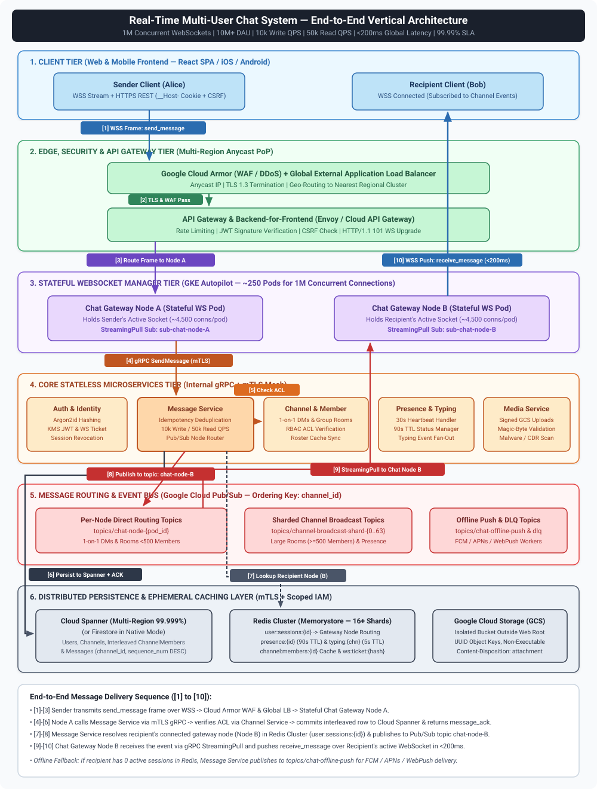
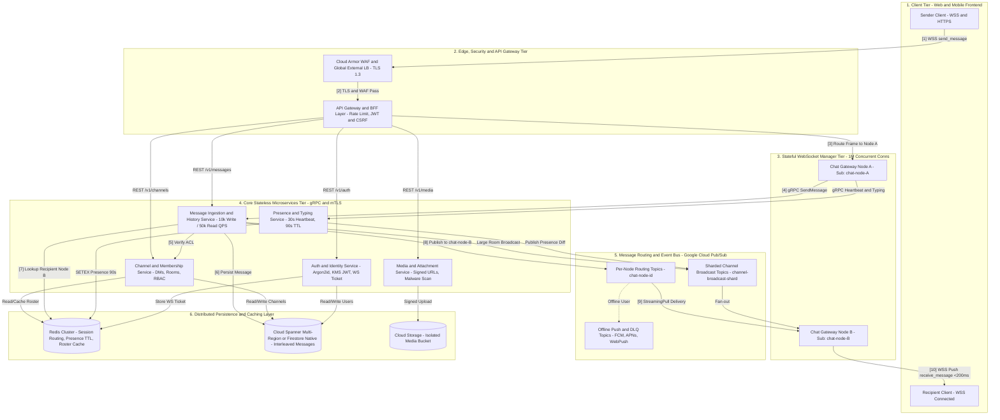

# High-Level Architecture Blueprint: Real-Time Multi-User Chat System

> [!IMPORTANT]
> **Specification Reference**: Generated from the **[Real-Time Multi-User Chat System Specification Document](https://docs.google.com/document/d/1_dCF0wfrX__W8cyqYVHYKz882pfCyeQdqVA0Ee6FQ2A/edit?tab=t.0)**, incorporating all functional (JWT authentication, 1-on-1 messaging, Group Rooms/Channels, Presence/Typing indicators, persistent Message History), scale (`<200ms` global latency, `99.99%` availability, `1M` concurrent WebSocket connections, `10M+` DAU, `10k QPS` write, `50k QPS` read), and microservice architecture requirements (`Auth Service`, `API Gateway & Load Balancer`, `Chat Service` with Google Cloud Pub/Sub, and `Storage Layer` with Cloud Spanner & Cloud Firestore Native Mode).

---

## 1. Executive Summary & Architectural Goals

This document defines the High-Level Architecture (HLA) for a globally distributed, real-time multi-user chat platform engineered to support **10M+ Daily Active Users (DAU)** and **1M concurrent WebSocket connections** with **<200ms global end-to-end latency** and **99.99% availability**.

### 1.1 Target Scale & Service Level Objectives (SLOs)

| Metric | Target Requirement | Architectural Strategy |
| :--- | :--- | :--- |
| **Global Latency (P99)** | `< 200 ms` (message send to recipient delivery) | Multi-region active-active edge termination (Google Cloud Global Load Balancer + Anycast IP), regional stateful WebSocket gateways, in-memory Redis routing, and regional Pub/Sub topics. |
| **Availability SLA** | `99.99%` (< 52.6 mins downtime/year) | Multi-region GKE Autopilot clusters, Cloud Spanner multi-region configuration (99.999% SLA), regional Redis Cluster with cross-region replication, zero-downtime rolling deployments with connection draining. |
| **Concurrent Connections** | `1,000,000` active WebSockets | ~200–250 Stateful `Chat Gateway` pods (4,000–5,000 connections/pod, tuned kernel epoll/kqueue file descriptors & memory buffers). |
| **Daily Active Users** | `10,000,000+` DAU | Stateless horizontal scaling for REST APIs, CDN caching for static & media assets, cursor-based pagination. |
| **Write Throughput** | `10,000 QPS` average (bursts to `50,000 QPS`) | Bit-reversed / UUIDv4 / hash-prefixed keys in Cloud Spanner to prevent shard hotspots; asynchronous write-behind batching for non-critical metadata. |
| **Read Throughput** | `50,000 QPS` (history, profiles, presence) | Read-through Redis Cluster cache for recent channel messages & membership lists + Cloud Spanner read-only stale reads (`exact_staleness: 1s`) for historical queries. |

---

## 2. Microservices Decomposition Principles

The system adheres strictly to **Microservice Architecture Principles**:

1. **Single Responsibility & Bounded Contexts (DDD)**: Each service owns a distinct domain boundary:
   - **Auth & Identity Service**: Authentication, OAuth2/OIDC, password hashing (Argon2id), JWT & WebSocket Ticket issuance, session revocation.
   - **Backend-for-Frontend (BFF) / API Gateway**: Unified ingress, TLS 1.3 termination, rate limiting, CSRF verification, cookie-to-JWT translation, and request aggregation.
   - **Chat Gateway Service (Stateful WebSocket Tier)**: Manages long-lived WebSocket connections, frame serialization/validation, heartbeats, and real-time push delivery. Contains zero business persistence logic.
   - **Message Service**: Owns message validation, idempotency deduplication, persistence into Cloud Spanner, message history queries, and Pub/Sub routing dispatch.
   - **Channel & Membership Service**: Manages 1-on-1 Direct Message (DM) channels, Group Rooms, RBAC permissions, and member rosters.
   - **Presence & Typing Service**: Manages ephemeral user status (`online`, `offline`, `away`, `dnd`) and typing indicators in Redis Cluster.
   - **Media & Attachment Service**: Handles secure file upload pre-signing, magic-byte inspection, Content Disarm & Reconstruction (CDR), and malware scanning.
2. **Database-per-Service & Least Privilege Isolation**: Each microservice accesses only its own logical schema/tables or dedicated data store using service-specific IAM service accounts over **mTLS** (`SELECT`-only roles for read paths, scoped DML roles for write paths; never root/admin).
3. **Stateless Compute vs. Stateful Edge Separation**: Only the `Chat Gateway Service` holds stateful socket descriptors. All business logic services (`Message`, `Channel`, `Auth`, `Presence`) are 100% stateless and autoscale independently on CPU/QPS metrics.
4. **Event-Driven Asynchronous Decoupling**: Services communicate synchronously via gRPC (with circuit breakers and deadlines) for command path validation, and asynchronously via **Google Cloud Pub/Sub** for real-time cross-node fan-out, push notifications, and analytics.

---

## 3. End-to-End Architecture Diagram

### 3.1 Rendered Visual Architecture Diagram (SVG)

### 3.2 Interactive Mermaid Architecture Diagram (Vertical `TB`)

### 3.3 Vertical Graphviz (`dot`) Specification (Task 4)

The following vertical Graphviz (`dot`) diagram (`rankdir=TB`, also saved in [`architecture.dot`](file:///Users/raniamoh/my-playground/sdlc-action/chat-system/docs/architecture.dot)) defines the component boundaries and the numbered flow (`[1]` through `[10]`):

```dot
digraph RealTimeChatSystem {
    rankdir=TB;
    fontsize=12;
    fontname="Helvetica";
    compound=true;
    nodesep=0.5;
    ranksep=0.75;
    splines=ortho;

    node [
        shape=box,
        style="rounded,filled",
        fontname="Helvetica",
        fontsize=10,
        margin="0.2,0.1"
    ];
    edge [
        fontname="Helvetica",
        fontsize=9,
        color="#4A5568"
    ];

    // ==========================================
    // 1. CLIENT TIER (FRONTEND)
    // ==========================================
    subgraph cluster_clients {
        label="1. Client Tier (Web / Mobile Frontend)";
        style="rounded,filled";
        fillcolor="#EBF8FF";
        color="#3182CE";

        sender_client [label="Sender Client\n(SPA / Mobile App)\nWebSocket + HTTPS", fillcolor="#BEE3F8", color="#2B6CB0"];
        recipient_client [label="Recipient Client\n(SPA / Mobile App)\nWebSocket + HTTPS", fillcolor="#BEE3F8", color="#2B6CB0"];
    }

    // ==========================================
    // 2. EDGE & API GATEWAY TIER
    // ==========================================
    subgraph cluster_edge {
        label="2. Edge, Security & API Gateway Tier (Multi-Region Anycast)";
        style="rounded,filled";
        fillcolor="#F0FFF4";
        color="#38A169";

        cloud_armor [label="Cloud Armor WAF & DDoS\n+ Global External App LB\n(TLS 1.3 Termination)", fillcolor="#C6F6D5", color="#2F855A"];
        api_gateway [label="API Gateway / BFF Layer\n(Envoy / Cloud API Gateway)\nRate Limiting, JWT & CSRF Check", fillcolor="#C6F6D5", color="#2F855A"];
    }

    // ==========================================
    // 3. STATEFUL WEBSOCKET GATEWAY TIER
    // ==========================================
    subgraph cluster_ws_tier {
        label="3. Stateful WebSocket Manager Tier (GKE Autopilot - 1M Concurrent Conns)";
        style="rounded,filled";
        fillcolor="#FAF5FF";
        color="#805AD5";

        chat_gw_1 [label="Chat Gateway Node A\n(Stateful WS Manager)\nSub: chat-node-A", fillcolor="#E9D8FD", color="#6B46C1"];
        chat_gw_2 [label="Chat Gateway Node B\n(Stateful WS Manager)\nSub: chat-node-B", fillcolor="#E9D8FD", color="#6B46C1"];
    }

    // ==========================================
    // 4. CORE STATELESS MICROSERVICES TIER
    // ==========================================
    subgraph cluster_microservices {
        label="4. Core Stateless Microservices Tier (gRPC + mTLS)";
        style="rounded,filled";
        fillcolor="#FFFAF0";
        color="#DD6B20";

        auth_svc [label="Auth & Identity Service\n(OAuth2/OIDC, Argon2id,\nJWT & WS Ticket Issuer)", fillcolor="#FEEBC8", color="#C05621"];
        msg_svc [label="Message Ingestion &\nHistory Service\n(10k Write / 50k Read QPS)", fillcolor="#FEEBC8", color="#C05621"];
        channel_svc [label="Channel & Membership\nService\n(DMs, Rooms, RBAC)", fillcolor="#FEEBC8", color="#C05621"];
        presence_svc [label="Presence & Typing\nService\n(Heartbeat, Online/Typing)", fillcolor="#FEEBC8", color="#C05621"];
        media_svc [label="Media & Attachment\nService\n(Signed URLs, Malware Scan)", fillcolor="#FEEBC8", color="#C05621"];
    }

    // ==========================================
    // 5. EVENT STREAMING & ROUTING BUS
    // ==========================================
    subgraph cluster_pubsub {
        label="5. Message Routing & Event Bus (Google Cloud Pub/Sub)";
        style="rounded,filled";
        fillcolor="#FFF5F5";
        color="#E53E3E";

        pubsub_node_topics [label="Per-Node Routing Topics\n(projects/*/topics/chat-node-{id})\nLow-Latency Unicast/Multicast", fillcolor="#FED7D7", color="#C53030"];
        pubsub_channel_topics [label="Large Channel Broadcast Topics\n(projects/*/topics/channel-events-{shard})\n& Presence Fan-out Topics", fillcolor="#FED7D7", color="#C53030"];
        pubsub_dlq [label="Dead Letter Topic (DLQ)\n& Offline Push Worker\n(FCM / APNs / WebPush)", fillcolor="#FED7D7", color="#C53030"];
    }

    // ==========================================
    // 6. PERSISTENCE & EPHEMERAL STORAGE LAYER
    // ==========================================
    subgraph cluster_storage {
        label="6. Distributed Storage & Caching Layer";
        style="rounded,filled";
        fillcolor="#EDF2F7";
        color="#4A5568";

        redis_cluster [label="Redis Cluster (Memorystore)\n- Session Routing (user -> node)\n- Ephemeral Presence & Typing TTL\n- Room Member Cache", shape=cylinder, fillcolor="#E2E8F0", color="#2D3748"];
        spanner_db [label="Cloud Spanner (Multi-Region)\nor Firestore Native Mode\n- Users, Channels, Memberships\n- Interleaved Messages History", shape=cylinder, fillcolor="#E2E8F0", color="#2D3748"];
        gcs_bucket [label="Cloud Storage (GCS)\nEncrypted Media Bucket\n(Outside Web Root)", shape=cylinder, fillcolor="#E2E8F0", color="#2D3748"];
    }

    // ==========================================
    // MESSAGE & CONTROL FLOWS
    // ==========================================

    // Edge Ingress
    sender_client -> cloud_armor [label="[1] WSS Frame (send_message)\n/ HTTPS REST", color="#2B6CB0", penwidth=1.8];
    recipient_client -> cloud_armor [label="WSS Connected", dir=both, style=dashed];
    cloud_armor -> api_gateway [label="[2] TLS Terminated\nWAF Verified", color="#2F855A", penwidth=1.8];

    // REST Auth & History Routing
    api_gateway -> auth_svc [label="REST /v1/auth/*"];
    api_gateway -> channel_svc [label="REST /v1/channels/*"];
    api_gateway -> msg_svc [label="REST GET /v1/channels/{id}/messages"];
    api_gateway -> media_svc [label="REST /v1/media/*"];

    // WebSocket Upgrade & Message Flow
    api_gateway -> chat_gw_1 [label="[3] Route WSS Frame\nto Connected Node A", color="#6B46C1", penwidth=1.8];
    api_gateway -> chat_gw_2 [label="WSS Connection\n(Recipient on Node B)", style=dashed];

    // Chat Gateway to Core Services
    chat_gw_1 -> msg_svc [label="[4] gRPC SendMessage\n(mTLS + Idempotency Key)", color="#C05621", penwidth=1.8];
    chat_gw_1 -> presence_svc [label="gRPC Heartbeat /\nTyping Event"];

    // Message Service Processing
    msg_svc -> channel_svc [label="[5] Verify ACL &\nGet Channel Members"];
    channel_svc -> redis_cluster [label="Read/Cache\nRoom Roster"];
    msg_svc -> spanner_db [label="[6] Persist Message\n(Interleaved Write)", color="#2D3748", penwidth=1.8];
    msg_svc -> redis_cluster [label="[7] Lookup Recipient\nGateway Node (Node B)", color="#2D3748", penwidth=1.8];

    // Pub/Sub Routing
    msg_svc -> pubsub_node_topics [label="[8] Publish DeliveryEnvelope\nto topic: chat-node-B", color="#C53030", penwidth=1.8];
    msg_svc -> pubsub_channel_topics [label="Publish Large Room\nBroadcast"];
    pubsub_node_topics -> chat_gw_2 [label="[9] Push/StreamingPull\nto Chat Gateway Node B", color="#C53030", penwidth=1.8];
    pubsub_channel_topics -> chat_gw_2 [label="Fan-out Delivery"];
    pubsub_node_topics -> pubsub_dlq [label="Undeliverable /\nOffline User", style=dotted];

    // Final Delivery to Recipient
    chat_gw_2 -> recipient_client [label="[10] WSS Push (receive_message)\n< 200ms End-to-End", color="#2B6CB0", penwidth=2.0];

    // Presence & Media Storage Connections
    presence_svc -> redis_cluster [label="SETEX Presence TTL\n& Routing Table"];
    presence_svc -> pubsub_channel_topics [label="Publish Presence Diff"];
    channel_svc -> spanner_db [label="Read/Write\nChannels & Members"];
    auth_svc -> spanner_db [label="Read/Write\nUser Credentials"];
    auth_svc -> redis_cluster [label="Store WS Ticket &\nRevocation List"];
    media_svc -> gcs_bucket [label="Signed Upload /\nMalware Sandbox"];
}
```

---

## 4. End-to-End Message Flow Summary

1. **`[1]` Client Send**: The Sender Client transmits a `send_message` JSON frame (containing a client-generated UUIDv4 `client_message_id` for idempotency) over its established `wss://` connection.
2. **`[2]` Edge Protection**: Google Cloud Armor filters DDoS/L7 attacks, terminates TLS 1.3 at the nearest edge PoP, and forwards traffic over Google's private fiber backbone to the regional **API Gateway / Envoy LB**.
3. **`[3]` Stateful Gateway Reception**: **`Chat Gateway Node A`** (which holds the sender's persistent WebSocket) validates the frame schema and rate limit token bucket for the socket.
4. **`[4]` gRPC Dispatch**: `Chat Gateway Node A` invokes `MessageService.SendMessage` via mTLS gRPC.
5. **`[5]` Membership & ACL Check**: `Message Service` queries `Channel Service` (backed by Redis cache `channel:members:{channel_id}`) to confirm the sender is an active member with `SEND_MESSAGE` permission.
6. **`[6]` Durable Persistence**: `Message Service` generates a globally monotonic `message_id` (ULID / Spanner commit timestamp + sequence) and commits the message to **Cloud Spanner** (`Messages` table interleaved in `Channels`). It immediately returns a `message_ack` to Node A -> Sender Client.
7. **`[7]` Routing Resolution**: `Message Service` performs a pipelined `HMGET` / `MGET` against **Redis Cluster** (`user:sessions:{user_id}`) for all target channel members to resolve which `Chat Gateway Node` (`node_id`) each online recipient is connected to.
8. **`[8]` Pub/Sub Fan-out**: `Message Service` groups online recipients by their `node_id` and publishes a batched `DeliveryEnvelope` to each target node's dedicated Cloud Pub/Sub topic (e.g., `chat-node-B`). For offline recipients with push notifications enabled, an event is routed to the Offline Push Worker topic.
9. **`[9]` Gateway Subscription Delivery**: **`Chat Gateway Node B`** receives the envelope via its low-latency streaming pull subscription on `chat-node-B`.
10. **`[10]` Real-Time Push**: `Chat Gateway Node B` looks up the recipient's local in-memory WebSocket descriptor and writes the `receive_message` frame. The recipient client acknowledges receipt and renders the message in `<200ms` end-to-end.

---

## 5. Capacity & Resource Estimation

- **Memory for 1M WebSockets**:
  - In Go or Rust (`tokio`/`tungstenite`), each idle WebSocket connection consumes ~15–25 KB of userspace + kernel TCP buffer memory.
  - $1,000,000 \times 25\text{ KB} \approx 25\text{ GB}$ total RAM across the cluster.
  - With 250 `Chat Gateway` pods (each allocated 2 vCPU, 2 GB RAM, handling 4,000 connections), connection memory is only ~100 MB/pod, leaving ample headroom for JSON serialization, TLS buffers, and Pub/Sub streaming pull buffers.
- **Network Bandwidth**:
  - Average payload size (with headers/framing): ~1 KB.
  - Write ingress: $10,000\text{ QPS} \times 1\text{ KB} = 10\text{ MB/s}$ ($80\text{ Mbps}$).
  - Read/Delivery fan-out (assuming average 5 online recipients per message across DMs and groups): $50,000\text{ deliveries/sec} \times 1\text{ KB} = 50\text{ MB/s}$ ($400\text{ Mbps}$).
- **Storage Growth**:
  - $10,000\text{ msgs/sec} \times 86,400\text{ sec/day} = 864,000,000\text{ messages/day}$.
  - At ~500 bytes/message (including indexes), daily storage growth is $\approx 432\text{ GB/day}$ ($\approx 157\text{ TB/year}$), easily handled by Cloud Spanner multi-region horizontal node scaling and tiered cold storage archival.

---

## 6. Security & Verification Plan

In accordance with mandatory secure design standards, the following security architecture controls and verification plan govern both Backend and Frontend implementations:

### 6.1 Mandatory Security Controls Checklist

1. **Authentication & Session Hardening**:
   - Passwords hashed exclusively with **Argon2id** (minimum 12 characters recommended, 8+ enforced, up to 128 characters, all characters allowed, unique cryptographic salt per user).
   - Primary browser session token provisioned via hardened HTTP cookie: `__Host-chat_session` with `HttpOnly; Secure; SameSite=Lax; Path=/` (no `Domain` attribute).
   - All state-changing REST requests (`POST`, `PUT`, `PATCH`, `DELETE`) enforce **Synchronizer / Double-Submit CSRF Token** validation (`X-CSRF-Token` header) in addition to `SameSite`.
   - WebSocket handshakes use a short-lived (30-second TTL), single-use cryptographic **WS Ticket** obtained via an authenticated POST call (never passing long-lived JWTs or credentials in URL query parameters).
   - **JWT Validation Rules**: Hardcode allowed verification algorithm (`RS256` / `EdDSA` via Cloud KMS public key), explicitly reject `alg: "none"`, enforce strict `exp`, `iss`, and `aud` claims, and never hardcode secrets or fallback strings in source code.
   - Full session invalidation across Redis and client memory upon logout, account deactivation, or organization removal.
   - `TODO(security)`: Integrate OAuth 2.0 / OIDC federated identity providers (Google, GitHub, Enterprise SAML/OIDC) alongside native password auth.
   - `TODO(security)`: Implement WebAuthn / TOTP Multi-Factor Authentication (MFA) for sensitive account operations.
   - `TODO(security)`: Integrate HaveIBeenPwned (k-anonymity range API) leaked password detection during signup and password rotation.
2. **Database Security & Least Privilege**:
   - Zero string concatenation in SQL; 100% parameterized queries (`@paramName` in Cloud Spanner).
   - Dedicated IAM service accounts per microservice with **mTLS** enforced on all connections and minimum required table privileges (e.g., History Reader service account granted `SELECT` only).
   - Generic error payloads returned to clients; internal SQL/Spanner diagnostics logged only to secure server logs without PII or tokens.
3. **File Upload Security**:
   - Strict allow-list of file types (`image/png`, `image/jpeg`, `image/webp`, `application/pdf`), verified server-side via magic-byte header inspection and structure validation.
   - Maximum file size enforced (10 MB max) at API Gateway and GCS signed policy level.
   - Uploaded files renamed to unpredictable UUIDv4 names, stored in an isolated GCS bucket outside the web root with non-executable permissions, and served with `Content-Disposition: attachment`, `X-Content-Type-Options: nosniff`, and exact `Content-Type`.
   - Hardened XML/SVG/PDF parsing (external entities, DTDs, XInclude, and network access disabled).
   - `TODO(security)`: Integrate automated antivirus/malware sandbox scanning API and Content Disarm & Reconstruction (CDR) pipeline before marking uploaded attachments as `READY`.
4. **Frontend XSS, CSP & PII Protection**:
   - Reliance on React JSX auto-escaping and safe DOM APIs (`textContent`, `createElement`, `replaceChildren`); complete ban on `innerHTML`, `outerHTML`, `document.write`, and unapproved `dangerouslySetInnerHTML`.
   - Strict HTTP headers: `Content-Security-Policy: default-src 'self'; script-src 'self' 'nonce-<random>'; connect-src 'self' wss://ws.chat.example.com; object-src 'none'; frame-ancestors 'none';`, `X-Frame-Options: DENY`, `X-Content-Type-Options: nosniff`, `Permissions-Policy: camera=(), microphone=(), geolocation=()`, and `Cache-Control: no-store`.
   - PII masking (`j***@example.com`, `***-***-1234`) in UI components, zero sensitive object logging in `console.log`, and custom modal components instead of native `alert()`/`confirm()`/`prompt()`.
   - Local testing servers and databases bound strictly to `127.0.0.1` / `localhost` (never `0.0.0.0`).
