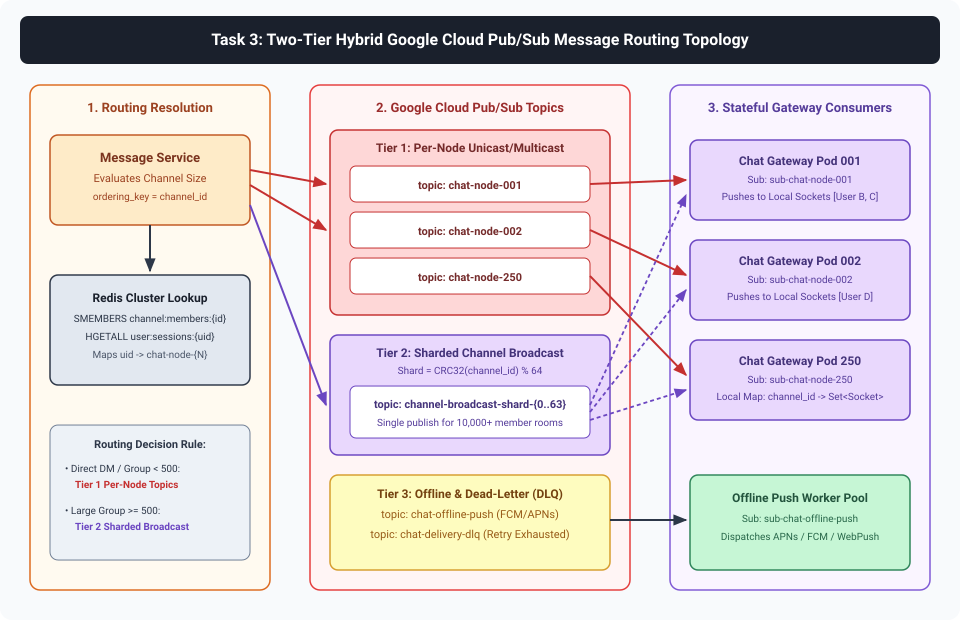
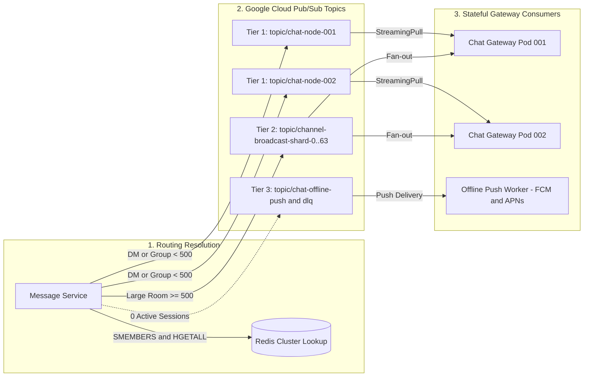
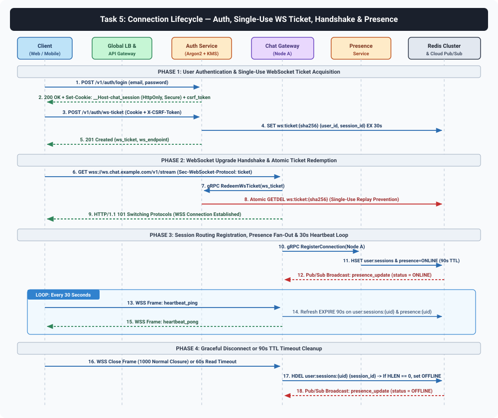
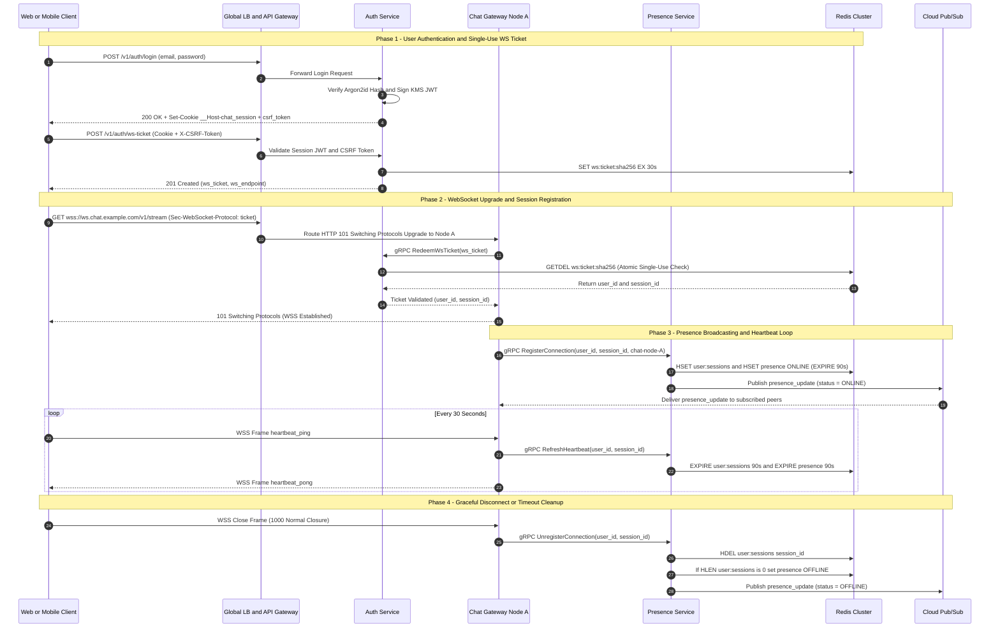

# Backend System Design Specification: Real-Time Multi-User Chat System

> [!IMPORTANT]
> **Specification Reference**: Generated based on the **[Real-Time Multi-User Chat System Specification Document](https://docs.google.com/document/d/1_dCF0wfrX__W8cyqYVHYKz882pfCyeQdqVA0Ee6FQ2A/edit?tab=t.0)**.

This document details the backend microservices architecture, REST and WebSocket API contracts, database schemas (**Cloud Spanner**, **Firestore in Native Mode**, and **Redis Cluster**), **Google Cloud Pub/Sub** message routing topology, and end-to-end **Connection & Presence Lifecycle**.

---

## 1. Backend Microservices Architecture

Each backend microservice is deployed as an independent Kubernetes `Deployment` (or StatefulSet for `Chat Gateway` nodes requiring predictable pod identities) on **Google Kubernetes Engine (GKE) Autopilot** across multiple regions (`us-central1`, `europe-west1`, `asia-east1`), communicating internally over **gRPC with mTLS (Anthos Service Mesh / Istio)**.

| Microservice | Scaling Model | Statefulness | Primary Data Store | Core Responsibilities |
| :--- | :--- | :--- | :--- | :--- |
| **API Gateway / BFF** | Stateless HPA (CPU/RPS) | Stateless | Redis (Rate Limits) | TLS termination, Cloud Armor WAF integration, CORS, strict HTTP security headers, CSRF token verification, JWT verification, request routing. |
| **Auth & Identity Service** | Stateless HPA | Stateless | Cloud Spanner (`Users`) + Redis (`ws:ticket`, `revoked_jti`) | Argon2id password authentication, OAuth2/OIDC login, `__Host-chat_session` cookie provisioning, short-lived single-use WebSocket ticket issuance, session revocation. |
| **Chat Gateway Service** | StatefulSet + Custom Metrics HPA (Active WS Count) | **Stateful** (Holds TCP/WS sockets) | Local Memory + Pub/Sub Subscriptions | Terminates 1M concurrent WebSockets (~4,000–5,000 connections/pod), validates inbound frames, dispatches gRPC commands, streams outbound events from node-specific Pub/Sub topics. |
| **Message Service** | Stateless HPA (QPS) | Stateless | Cloud Spanner (`Messages`, `ReadReceipts`) | Idempotency check (`client_message_id`), monotonic ULID/timestamp ordering, durable persistence (10k write QPS), cursor-paginated history queries (50k read QPS), Pub/Sub routing resolution. |
| **Channel & Membership Service** | Stateless HPA | Stateless | Cloud Spanner (`Channels`, `ChannelMembers`) + Redis Cache | 1-on-1 DM creation, Group Room lifecycle, RBAC enforcement (`OWNER`, `ADMIN`, `MEMBER`), cached member roster lookups. |
| **Presence & Typing Service** | Stateless HPA | Stateless | Redis Cluster (`presence:*`, `typing:*`) | Processes 30-second client heartbeats, maintains TTL-backed online/away/offline status, aggregates presence diffs, routes ephemeral `typing_indicator` events. |
| **Media & Attachment Service** | Stateless HPA | Stateless | Cloud Storage (GCS) + Cloud Spanner (`Attachments`) | Issues V4 signed upload URLs, validates magic bytes & file size (max 10 MB), orchestrates malware sandbox & CDR stripping, serves files with `Content-Disposition: attachment` and `nosniff`. |

---

## 2. Task 1: API Design (REST Endpoints & WebSocket Payloads)

### 2.1 Security & Transport Conventions

- **Transport**: All REST endpoints require **HTTPS (TLS 1.3)** (`https://api.chat.example.com/v1/*`). All WebSocket connections require **WSS** (`wss://ws.chat.example.com/v1/stream`).
- **Session Cookie & CSRF**:
  - Browser clients authenticate via `Cookie: __Host-chat_session=<signed_jwt>; Secure; HttpOnly; SameSite=Lax; Path=/`.
  - Every state-changing request (`POST`, `PUT`, `PATCH`, `DELETE`) **MUST** include the `X-CSRF-Token` header matching the cryptographic double-submit/synchronizer token bound to the user's session.
- **HTTP Method Allow-List**: Only `GET`, `POST`, `PATCH`, `DELETE`, and `OPTIONS` are permitted at the API Gateway; `TRACE`, `CONNECT`, and `PUT` (unless explicitly mapped) are rejected with `405 Method Not Allowed`.
- **Rate Limiting**: Enforced per `user_id` and IP via Redis sliding-window counters (e.g., `60 req/min` for auth, `1200 req/min` for message reads, `60 msgs/min` per user on WebSocket `send_message`).

---

### 2.2 Core REST API Endpoints

#### A. Authentication & WebSocket Ticket Issuance

##### 1. `POST /v1/auth/login`
Authenticates a user and sets the hardened `__Host-chat_session` cookie and returns a CSRF token.

- **Request Payload**:
```json
{
  "email": "alice@example.com",
  "password": "<USER_SUPPLIED_CREDENTIAL>"
}
```
- **Response (`200 OK`)**:
  - **Headers**:
    - `Set-Cookie: __Host-chat_session=eyJhbGciOiJSUzI1NiIsImtpZCI6Imttcy1rZXktMSJ9...; Path=/; Secure; HttpOnly; SameSite=Lax; Max-Age=3600`
    - `Cache-Control: no-store`
    - `X-Content-Type-Options: nosniff`
    - `X-Frame-Options: DENY`
```json
{
  "user": {
    "user_id": "usr_01J8Z9K2M4N6P8Q0R2S4T6V8W0",
    "username": "alice",
    "display_name": "Alice Nguyen",
    "masked_email": "a***e@example.com",
    "avatar_url": "https://cdn.chat.example.com/avatars/a1b2c3d4.webp"
  },
  "csrf_token": "csrf_9f8e7d6c5b4a3f2e1d0c9b8a7f6e5d4c",
  "expires_in_seconds": 3600
}
```

##### 2. `POST /v1/auth/ws-ticket`
Generates a **single-use, 30-second TTL WebSocket connection ticket** so credentials/JWTs are never exposed in WebSocket URL query strings or browser logs.

- **Request Headers**: `Cookie: __Host-chat_session=...`, `X-CSRF-Token: csrf_9f8e7d6c...`
- **Response (`201 Created`)**:
```json
{
  "ws_ticket": "wst_4f9a2b8c1d7e6f3a5b0c9d8e7f6a5b4c3d2e1f0a",
  "ws_endpoint": "wss://ws.chat.example.com/v1/stream",
  "expires_at": "2026-10-20T15:14:01Z"
}
```

##### 3. `POST /v1/auth/logout`
Revokes the active session in Redis (`revoked_jti:{jti}`), terminates active WebSocket connections for the session, and clears the `__Host-chat_session` cookie.

---

#### B. Channel & Group Management

##### 4. `POST /v1/channels`
Creates either a `DIRECT` (1-on-1 DM) channel or a `GROUP` room. For `DIRECT` channels, if a pair already exists between the two users (`dm_pair_hash`), the existing channel is returned idempotently.

- **Request Headers**: `Cookie: __Host-chat_session=...`, `X-CSRF-Token: ...`
- **Request Payload**:
```json
{
  "type": "GROUP",
  "name": "platform-architecture",
  "topic": "Real-Time Chat System Architecture Discussion",
  "is_private": true,
  "member_user_ids": [
    "usr_01J8Z9K2M4N6P8Q0R2S4T6V8W0",
    "usr_01J8Z9K5X7Y9Z1A3B5C7D9E1F3"
  ],
  "idempotency_key": "550e8400-e29b-41d4-a716-446655440000"
}
```
- **Response (`201 Created`)**:
```json
{
  "channel_id": "chn_01J8ZA1B2C3D4E5F6G7H8J9K0M",
  "type": "GROUP",
  "name": "platform-architecture",
  "topic": "Real-Time Chat System Architecture Discussion",
  "is_private": true,
  "created_by": "usr_01J8Z9K2M4N6P8Q0R2S4T6V8W0",
  "member_count": 2,
  "created_at": "2026-10-20T15:10:00Z"
}
```

##### 5. `GET /v1/channels`
Lists all channels the authenticated user belongs to, sorted by `last_message_at DESC`, including unread counts and last message preview.

##### 6. `POST /v1/channels/{channel_id}/members`
Adds members to a group channel (requires `OWNER` or `ADMIN` role in `ChannelMembers`).

---

#### C. Message History & Read Receipts

##### 7. `GET /v1/channels/{channel_id}/messages?limit=50&before_cursor=msg_01J8Z...`
Fetches persistent message history using keyset/cursor pagination (`before_cursor` or `after_cursor` based on `(channel_id, created_at, message_id)`). Optimized for **50k QPS read** via Redis hot-window cache (latest 100 messages/channel) backed by Cloud Spanner interleaved table reads.

- **Response (`200 OK`)**:
```json
{
  "channel_id": "chn_01J8ZA1B2C3D4E5F6G7H8J9K0M",
  "messages": [
    {
      "message_id": "msg_01J8ZB9X8W7V6U5T4S3R2Q1P0N",
      "client_message_id": "c7b3d8e0-5e0b-4b0f-8b3a-3b9f4b3d3b3d",
      "channel_id": "chn_01J8ZA1B2C3D4E5F6G7H8J9K0M",
      "sender_id": "usr_01J8Z9K2M4N6P8Q0R2S4T6V8W0",
      "content": "Here is the updated Cloud Spanner schema.",
      "content_type": "TEXT",
      "attachments": [],
      "reply_to_message_id": null,
      "sequence_num": 1042,
      "created_at": "2026-10-20T15:12:10.124Z",
      "edited_at": null,
      "is_deleted": false
    }
  ],
  "pagination": {
    "next_before_cursor": "eyJjcmVhdGVkX2F0IjoiMjAyNi0xMC0yMFQxNToxMjoxMC4xMjRaIiwibWlkIjoibXNnXzAxSjhaQjlYOFc3VjZVNVQ0UzNSMlExUDBOIn0=",
    "has_more": true
  }
}
```

#### D. Presence Batch Lookup

##### 8. `POST /v1/presence/query`
Fetches current online/offline status for a batch of up to 100 `user_ids` from Redis Cluster.

- **Request Payload**:
```json
{
  "user_ids": [
    "usr_01J8Z9K2M4N6P8Q0R2S4T6V8W0",
    "usr_01J8Z9K5X7Y9Z1A3B5C7D9E1F3"
  ]
}
```
- **Response (`200 OK`)**:
```json
{
  "statuses": [
    {
      "user_id": "usr_01J8Z9K2M4N6P8Q0R2S4T6V8W0",
      "status": "ONLINE",
      "custom_status": "In a design review",
      "last_seen_at": "2026-10-20T15:13:30Z"
    },
    {
      "user_id": "usr_01J8Z9K5X7Y9Z1A3B5C7D9E1F3",
      "status": "OFFLINE",
      "custom_status": null,
      "last_seen_at": "2026-10-20T14:40:12Z"
    }
  ]
}
```

---

### 2.3 WebSocket Event Payloads (`wss://ws.chat.example.com/v1/stream`)

All WebSocket frames use a standardized JSON envelope with `event_type`, `trace_id`, `timestamp`, and `payload`.

#### 1. Client -> Server: `send_message`
Sent by a client to post a message to a 1-on-1 DM or Group Channel.

```json
{
  "event_type": "send_message",
  "trace_id": "trc_8a7b6c5d4e3f2a1b",
  "timestamp": "2026-10-20T15:13:00.050Z",
  "payload": {
    "client_message_id": "c7b3d8e0-5e0b-4b0f-8b3a-3b9f4b3d3b3d",
    "channel_id": "chn_01J8ZA1B2C3D4E5F6G7H8J9K0M",
    "content": "Hello team! Are we ready for the 1M connection load test?",
    "content_type": "TEXT",
    "attachment_ids": [],
    "reply_to_message_id": null
  }
}
```

#### 2. Server -> Sender Client: `message_ack`
Returned to the sender immediately after Cloud Spanner persistence, reconciling the optimistic `client_message_id` with the canonical `message_id` and `sequence_num`.

```json
{
  "event_type": "message_ack",
  "trace_id": "trc_8a7b6c5d4e3f2a1b",
  "timestamp": "2026-10-20T15:13:00.092Z",
  "payload": {
    "client_message_id": "c7b3d8e0-5e0b-4b0f-8b3a-3b9f4b3d3b3d",
    "message_id": "msg_01J8ZC1D2E3F4G5H6J7K8L9M0N",
    "channel_id": "chn_01J8ZA1B2C3D4E5F6G7H8J9K0M",
    "sequence_num": 1043,
    "status": "PERSISTED",
    "server_created_at": "2026-10-20T15:13:00.088Z"
  }
}
```

#### 3. Server -> Recipient Clients: `receive_message`
Pushed to all online channel members via their respective `Chat Gateway` nodes.

```json
{
  "event_type": "receive_message",
  "trace_id": "trc_8a7b6c5d4e3f2a1b",
  "timestamp": "2026-10-20T15:13:00.115Z",
  "payload": {
    "message_id": "msg_01J8ZC1D2E3F4G5H6J7K8L9M0N",
    "client_message_id": "c7b3d8e0-5e0b-4b0f-8b3a-3b9f4b3d3b3d",
    "channel_id": "chn_01J8ZA1B2C3D4E5F6G7H8J9K0M",
    "sender": {
      "user_id": "usr_01J8Z9K2M4N6P8Q0R2S4T6V8W0",
      "username": "alice",
      "display_name": "Alice Nguyen",
      "avatar_url": "https://cdn.chat.example.com/avatars/a1b2c3d4.webp"
    },
    "content": "Hello team! Are we ready for the 1M connection load test?",
    "content_type": "TEXT",
    "attachments": [],
    "reply_to_message_id": null,
    "sequence_num": 1043,
    "created_at": "2026-10-20T15:13:00.088Z"
  }
}
```

#### 4. Bidirectional: `typing_indicator`
Ephemeral event (never written to Cloud Spanner; throttled to once every 3 seconds per user).

```json
{
  "event_type": "typing_indicator",
  "trace_id": "trc_1f2e3d4c5b6a7988",
  "timestamp": "2026-10-20T15:13:02.000Z",
  "payload": {
    "channel_id": "chn_01J8ZA1B2C3D4E5F6G7H8J9K0M",
    "user_id": "usr_01J8Z9K5X7Y9Z1A3B5C7D9E1F3",
    "username": "bob",
    "is_typing": true,
    "ttl_seconds": 5
  }
}
```

#### 5. Server -> Client: `presence_update`
Broadcast to peers sharing active channels or explicit presence subscriptions when a user's state changes.

```json
{
  "event_type": "presence_update",
  "trace_id": "trc_9988776655443322",
  "timestamp": "2026-10-20T15:13:05.000Z",
  "payload": {
    "user_id": "usr_01J8Z9K5X7Y9Z1A3B5C7D9E1F3",
    "status": "ONLINE",
    "custom_status": "Available",
    "last_seen_at": "2026-10-20T15:13:05.000Z"
  }
}
```

#### 6. Bidirectional: `read_receipt`
Marks messages in a channel as read up to `last_read_sequence_num` / `last_read_message_id`.

```json
{
  "event_type": "read_receipt",
  "trace_id": "trc_5544332211009988",
  "timestamp": "2026-10-20T15:13:10.000Z",
  "payload": {
    "channel_id": "chn_01J8ZA1B2C3D4E5F6G7H8J9K0M",
    "user_id": "usr_01J8Z9K5X7Y9Z1A3B5C7D9E1F3",
    "last_read_message_id": "msg_01J8ZC1D2E3F4G5H6J7K8L9M0N",
    "last_read_sequence_num": 1043,
    "read_at": "2026-10-20T15:13:10.000Z"
  }
}
```

#### 7. Bidirectional: `heartbeat_ping` / `heartbeat_pong`
Application-level keep-alive sent every 30 seconds by the client to refresh presence TTL in Redis.

```json
{
  "event_type": "heartbeat_ping",
  "trace_id": "trc_ping_001",
  "timestamp": "2026-10-20T15:13:30.000Z",
  "payload": {
    "client_time": 1792509210000,
    "active_channel_id": "chn_01J8ZA1B2C3D4E5F6G7H8J9K0M"
  }
}
```

---

## 3. Task 2: Database Schema Design

### 3.1 Option A (Recommended Primary): Cloud Spanner Multi-Region DDL

**Why Cloud Spanner?**
- Provides external consistency (TrueTime) across regions with **99.999% availability**.
- **Table Interleaving** (`INTERLEAVE IN PARENT Channels`) physically co-locates `Messages` and `ChannelMembers` rows with their parent `Channels` split on disk, enabling single-split locality for fetching channel history (`50k QPS` reads) and membership validation.
- **Hotspot Avoidance**: `channel_id` and `user_id` are prefixed with a deterministic 4-hex-character hash shard or random ULID/UUIDv4 component so writes (`10k QPS`) distribute uniformly across all Spanner splits without sequential timestamp hotspotting.

```sql
-- ============================================================
-- 1. USERS TABLE
-- ============================================================
CREATE TABLE Users (
    user_id STRING(36) NOT NULL,               -- UUIDv4 / Hash-prefixed ID
    username STRING(64) NOT NULL,
    email_hash BYTES(32) NOT NULL,             -- SHA-256 for blind index lookup
    encrypted_email BYTES(256) NOT NULL,       -- KMS envelope-encrypted PII
    password_hash STRING(255) NOT NULL,        -- Argon2id PHC string ($argon2id$v=19$...)
    display_name STRING(128) NOT NULL,
    avatar_url STRING(512),
    account_status STRING(20) NOT NULL DEFAULT ('ACTIVE'), -- ACTIVE, SUSPENDED, DELETED
    created_at TIMESTAMP NOT NULL OPTIONS (allow_commit_timestamp=true),
    updated_at TIMESTAMP NOT NULL OPTIONS (allow_commit_timestamp=true),
) PRIMARY KEY (user_id);

CREATE UNIQUE INDEX idx_users_username ON Users(username);
CREATE UNIQUE INDEX idx_users_email_hash ON Users(email_hash);

-- ============================================================
-- 2. CHANNELS TABLE (1-on-1 DMs and Group Rooms)
-- ============================================================
CREATE TABLE Channels (
    channel_id STRING(36) NOT NULL,            -- Shard-distributed UUID/ULID
    type STRING(16) NOT NULL,                  -- 'DIRECT' | 'GROUP'
    dm_pair_hash STRING(64),                   -- SHA-256(min(u1,u2) + ":" + max(u1,u2)) for 1-on-1 uniqueness
    name STRING(128),                          -- Null for DIRECT, set for GROUP
    topic STRING(512),
    is_private BOOL NOT NULL DEFAULT (true),
    created_by STRING(36) NOT NULL,
    member_count INT64 NOT NULL DEFAULT (0),
    last_sequence_num INT64 NOT NULL DEFAULT (0),
    last_message_at TIMESTAMP OPTIONS (allow_commit_timestamp=true),
    created_at TIMESTAMP NOT NULL OPTIONS (allow_commit_timestamp=true),
    updated_at TIMESTAMP NOT NULL OPTIONS (allow_commit_timestamp=true),
) PRIMARY KEY (channel_id);

-- Prevents duplicate 1-on-1 DM channels between the same two users
CREATE UNIQUE NULL_FILTERED INDEX idx_channels_dm_pair ON Channels(dm_pair_hash);

-- ============================================================
-- 3. CHANNEL MEMBERS TABLE (Interleaved in Channels)
-- Co-located with parent Channel for sub-millisecond roster lookups
-- ============================================================
CREATE TABLE ChannelMembers (
    channel_id STRING(36) NOT NULL,
    user_id STRING(36) NOT NULL,
    role STRING(16) NOT NULL DEFAULT ('MEMBER'), -- 'OWNER' | 'ADMIN' | 'MEMBER'
    is_muted BOOL NOT NULL DEFAULT (false),
    last_read_sequence_num INT64 NOT NULL DEFAULT (0),
    last_read_message_id STRING(36),
    joined_at TIMESTAMP NOT NULL OPTIONS (allow_commit_timestamp=true),
) PRIMARY KEY (channel_id, user_id),
  INTERLEAVE IN PARENT Channels ON DELETE CASCADE;

-- Secondary index to quickly query all channels a given user belongs to
CREATE INDEX idx_user_channels
    ON ChannelMembers(user_id, joined_at DESC)
    STORING (role, is_muted, last_read_sequence_num);

-- ============================================================
-- 4. MESSAGES TABLE (Interleaved in Channels)
-- Clustered by (channel_id, sequence_num DESC) for fast history scans
-- ============================================================
CREATE TABLE Messages (
    channel_id STRING(36) NOT NULL,
    sequence_num INT64 NOT NULL,               -- Monotonically increasing per-channel counter
    message_id STRING(36) NOT NULL,            -- Globally unique ULID
    client_message_id STRING(36) NOT NULL,     -- Client UUIDv4 for idempotency
    sender_id STRING(36) NOT NULL,
    content STRING(4096) NOT NULL,
    content_type STRING(24) NOT NULL DEFAULT ('TEXT'), -- 'TEXT' | 'SYSTEM' | 'MEDIA'
    reply_to_message_id STRING(36),
    is_deleted BOOL NOT NULL DEFAULT (false),
    created_at TIMESTAMP NOT NULL OPTIONS (allow_commit_timestamp=true),
    edited_at TIMESTAMP OPTIONS (allow_commit_timestamp=true),
) PRIMARY KEY (channel_id, sequence_num DESC),
  INTERLEAVE IN PARENT Channels ON DELETE CASCADE;

-- Enforces idempotent message retries per sender within a channel
CREATE UNIQUE INDEX idx_messages_idempotency
    ON Messages(channel_id, sender_id, client_message_id);

-- Enables direct lookup by message_id within a channel
CREATE UNIQUE INDEX idx_messages_by_id
    ON Messages(channel_id, message_id);

-- ============================================================
-- 5. ATTACHMENTS TABLE (Interleaved in Messages)
-- ============================================================
CREATE TABLE Attachments (
    channel_id STRING(36) NOT NULL,
    sequence_num INT64 NOT NULL,
    attachment_id STRING(36) NOT NULL,
    storage_object_key STRING(256) NOT NULL,   -- Random UUID key in isolated GCS bucket
    original_filename STRING(255) NOT NULL,
    mime_type STRING(64) NOT NULL,             -- Allow-listed: image/png, image/jpeg, application/pdf
    size_bytes INT64 NOT NULL,                 -- Enforced <= 10,485,760 (10 MB)
    scan_status STRING(20) NOT NULL DEFAULT ('PENDING'), -- 'PENDING' | 'CLEAN' | 'QUARANTINED'
    created_at TIMESTAMP NOT NULL OPTIONS (allow_commit_timestamp=true),
) PRIMARY KEY (channel_id, sequence_num DESC, attachment_id),
  INTERLEAVE IN PARENT Messages ON DELETE CASCADE;
```

#### Parameterized Query Examples (Zero String Concatenation)
- **Fetch Paginated History (50k QPS Path)**:
```sql
SELECT message_id, client_message_id, sender_id, content, content_type,
       reply_to_message_id, sequence_num, created_at, edited_at
FROM Messages
WHERE channel_id = @channelId
  AND sequence_num < @beforeSequenceNum
  AND is_deleted = FALSE
ORDER BY sequence_num DESC
LIMIT @pageSize;
```

---

### 3.2 Option B (Alternative Document Model): Cloud Firestore in Native Mode

If deployed using **Cloud Firestore in Native Mode**, collections are structured to avoid the 1 write/sec per document contention limit and support collection-group queries:

- `/users/{userId}`
  - Fields: `username`, `displayName`, `avatarUrl`, `accountStatus`, `createdAt`
- `/channels/{channelId}`
  - Fields: `type` (`DIRECT`|`GROUP`), `dmPairHash`, `name`, `topic`, `memberCount`, `lastMessageAt`, `lastMessagePreview`
  - Subcollection `/channels/{channelId}/members/{userId}`
    - Fields: `userId`, `channelId`, `role`, `joinedAt`, `lastReadMessageId`
    - *Collection Group Index* on `members` (`userId ASC, joinedAt DESC`) to list all channels for a user.
  - Subcollection `/channels/{channelId}/messages/{messageId}`
    - Document ID: `messageId` (ULID prefixed with a 2-byte random shard suffix when write rate per single channel exceeds 500 QPS).
    - Fields: `clientMessageId`, `senderId`, `content`, `contentType`, `sequenceNum`, `createdAt`, `editedAt`, `isDeleted`
    - *Composite Index*: `(isDeleted ASC, createdAt DESC, __name__ DESC)` for cursor-based history pagination.

---

### 3.3 Redis Cluster Schema (Ephemeral Presence, Routing & Hot Cache)

Deployed on **Google Cloud Memorystore for Redis Cluster** (sharded across 16+ shards with read replicas, supporting >500k ops/sec at `<1ms` latency):

| Key Pattern | Redis Data Type | TTL | Value Structure & Purpose |
| :--- | :--- | :--- | :--- |
| `user:sessions:{user_id}` | `HASH` | `90s` (refreshed every 30s) | Maps `device_session_id -> chat_gateway_node_id` (e.g., `{"sess_web_1": "chat-node-a4", "sess_ios_2": "chat-node-b2"}`). Used by `Message Service` to route messages to the exact gateway node(s) holding the recipient's WebSockets. |
| `presence:{user_id}` | `HASH` | `90s` (refreshed on heartbeat) | `{"status": "ONLINE", "custom": "In a meeting", "last_seen": "1792509210", "node": "chat-node-a4"}`. |
| `typing:{channel_id}` | `ZSET` | `10s` | Sorted set of `user_id` scored by expiration Unix timestamp (`now + 5s`). |
| `channel:members:{channel_id}` | `SET` | `300s` (write-through invalidated) | Set of `user_id` strings belonging to `channel_id`. Avoids hitting Spanner on every message send. |
| `channel:large_nodes:{channel_id}` | `SET` | `120s` | For large channels (>500 members), tracks active `chat_gateway_node_id`s currently holding at least 1 connected member. |
| `ws:ticket:{ticket_sha256}` | `STRING` | `30s` (consumed via `GETDEL`) | JSON `{"user_id": "...", "session_id": "...", "ip": "..."}`. Atomic `GETDEL` guarantees single-use WebSocket upgrade verification. |

---

## 4. Task 3: Message Routing Topology (Google Cloud Pub/Sub)

With **1M concurrent WebSocket connections** distributed across **~250 stateful `Chat Gateway` pods**, a sender connected to `chat-node-A` frequently sends messages to recipients connected to `chat-node-B`, `chat-node-C`, etc.

To maintain **<200ms end-to-end latency** without saturating network links with unnecessary broadcasts, we implement a **Two-Tier Hybrid Pub/Sub Routing Topology**:





### 4.1 Tier 1: Per-Node Direct Routing Topics (1-on-1 DMs & Standard Groups `< 500` Members)

```
Topic Naming:        projects/{project_id}/topics/chat-node-{pod_uid}
Subscription Naming: projects/{project_id}/subscriptions/sub-chat-node-{pod_uid}
```

1. **Pod Startup**: When `Chat Gateway` pod `chat-node-042` boots, it registers its dedicated topic and initiates a persistent gRPC **StreamingPull** subscription (`sub-chat-node-042`) with `max_outstanding_messages = 10,000`.
2. **Recipient Node Lookup**:
   - When `Message Service` processes a message for `channel_id`, it fetches the member list from Redis (`SMEMBERS channel:members:{channel_id}`).
   - It executes a Redis pipeline of `HGETALL user:sessions:{member_id}` across the member list.
   - Suppose User B is on `chat-node-019` (Web) and `chat-node-104` (Mobile), and User C is on `chat-node-019`.
3. **Node-Grouped Batching**:
   - `Message Service` groups recipients by target node:
     - `chat-node-019` -> `[User B (sess_web), User C (sess_web)]`
     - `chat-node-104` -> `[User B (sess_mobile)]`
   - It publishes **one** `NodeDeliveryEnvelope` message to `projects/*/topics/chat-node-019` and **one** to `projects/*/topics/chat-node-104` with `ordering_key = channel_id`.
4. **Local Socket Dispatch**:
   - `chat-node-019` receives the envelope via StreamingPull, iterates over the local target socket IDs `[User B, User C]`, and writes the serialized `receive_message` frame directly to both sockets concurrently.

### 4.2 Tier 2: Sharded Channel Broadcast Topics (Large Channels `>= 500` Members)

For large rooms (e.g., town halls or public channels with 10,000 members), looking up 10,000 individual user sessions in Redis per message is inefficient. Instead, we switch automatically to **Channel Broadcast Routing** when `Channel.member_count >= 500`:

```
Topic Naming:        projects/{project_id}/topics/channel-broadcast-shard-{0..63}
                     (Shard = CRC32(channel_id) % 64)
Subscription Naming: projects/{project_id}/subscriptions/sub-broadcast-{pod_uid}-shard-{0..63}
```

1. Each `Chat Gateway` pod maintains a local in-memory routing map: `local_channel_sockets: Map<channel_id, Set<SocketID>>`.
2. When a message is posted to a large channel, `Message Service` publishes **a single Pub/Sub message** to `channel-broadcast-shard-{CRC32(channel_id) % 64}` (or uses Redis `SMEMBERS channel:large_nodes:{channel_id}` to publish only to the node topics that currently have active listeners for that channel).
3. Each subscribed `Chat Gateway` pod checks its `local_channel_sockets[channel_id]` map and fans the message out in-memory to all locally connected members.

### 4.3 Reliability, Ordering & Dead-Letter Handling

- **Per-Channel Ordering**: Cloud Pub/Sub message ordering is enabled with `ordering_key = channel_id`, guaranteeing that `Chat Gateway` nodes receive messages for any given channel in strict `sequence_num` order.
- **Offline Push Fallback & DLQ**:
  - Recipients with zero active entries in `user:sessions:{user_id}` are collected into an `OfflineNotificationEvent` and published to `projects/{project_id}/topics/chat-offline-push` (consumed by Push Notification Workers for FCM/APNs/WebPush).
  - If a `Chat Gateway` pod crashes mid-delivery and fails to `ACK` a Pub/Sub message within the 10-second `ackDeadlineSeconds`, or if a socket has disconnected during transit, the message is routed to `projects/{project_id}/topics/chat-delivery-dlq` so the Offline Push Worker or client reconnect catch-up handles delivery.

---

## 5. Task 5: Connection Lifecycle (Auth, WebSocket Handshake & Presence)

### 5.1 End-to-End Sequence Diagram





### 5.2 Detailed Lifecycle Walkthrough

1. **Step 1 — Authentication & Hardened Session Provisioning**:
   - The client submits credentials to `POST /v1/auth/login`.
   - `Auth Service` verifies the password using **Argon2id** (`m=65536, t=3, p=4`), generates a short-lived JWT (`exp = 15m` to `1h`) signed with an asymmetric private key held in **Cloud KMS** (`RS256` / `EdDSA`), and sets the `__Host-chat_session` cookie (`HttpOnly; Secure; SameSite=Lax; Path=/`) along with a synchronizer `csrf_token`.
2. **Step 2 — Ephemeral WebSocket Ticket Exchange**:
   - Because browser WebSocket APIs cannot attach custom `Authorization` headers directly and passing long-lived JWTs in URL query strings (`?token=...`) violates security rules (leaking secrets in proxy/access logs), the client calls `POST /v1/auth/ws-ticket` (authenticated via cookie + `X-CSRF-Token`).
   - `Auth Service` generates a 256-bit random `ws_ticket`, stores its SHA-256 hash in Redis (`ws:ticket:{hash}`) with a strict `30-second TTL`, and returns the ticket to the client.
3. **Step 3 — WebSocket Handshake & Atomic Ticket Redemption**:
   - The client opens `wss://ws.chat.example.com/v1/stream` passing the single-use ticket via the `Sec-WebSocket-Protocol` header (or cookies if same-origin).
   - The Global Load Balancer routes the upgrade request to the least-loaded regional `Chat Gateway` pod (`chat-node-A`).
   - `chat-node-A` calls `AuthService.RedeemWsTicket`, which executes an atomic Redis `GETDEL ws:ticket:{hash}`. If the key exists, the ticket is consumed and cannot be replayed; if missing/expired, the handshake is rejected with `401 Unauthorized` (fail-closed).
4. **Step 4 — Session Registration & Initial Presence Fan-Out**:
   - `chat-node-A` registers the connection in its local in-memory connection table (`Map<user_id, Map<session_id, WebSocket>>`) and invokes `PresenceService.RegisterConnection`.
   - `Presence Service` updates `user:sessions:{user_id}` (`HSET` mapping `session_id -> chat-node-A`) and `presence:{user_id}` (`status = ONLINE`) in Redis with a `90-second TTL`.
   - If the user transitioned from `OFFLINE` to `ONLINE`, `Presence Service` resolves the user's active channels and publishes a `presence_update` event via Pub/Sub to notify online peers.
   - Simultaneously, `chat-node-A` queries `Message Service` for any messages created after the client's `last_known_sequence_num` and pushes missed messages over the newly established socket.
5. **Step 5 — Keep-Alive Heartbeats & Ungraceful Disconnect Detection**:
   - Every **30 seconds**, the client sends a `heartbeat_ping` frame. `chat-node-A` responds with `heartbeat_pong` and batches heartbeat refreshes to `Presence Service`, resetting the `90-second TTL` in Redis.
   - **Graceful Disconnect**: When a user closes the tab or logs out, the client sends a WebSocket `CLOSE (1000)` frame. `chat-node-A` immediately removes `session_id` from `user:sessions:{user_id}`. If the user has no remaining active sessions (`HLEN == 0`), `Presence Service` marks the user `OFFLINE` and broadcasts `presence_update`.
   - **Ungraceful Disconnect (Network Drop / Pod Crash)**: If a client loses connectivity without a TCP FIN/RST, `chat-node-A`'s read deadline (60s) or Redis's key expiration (`90s TTL` with keyspace notification listener) triggers automatic session cleanup and broadcasts `status: OFFLINE`.
