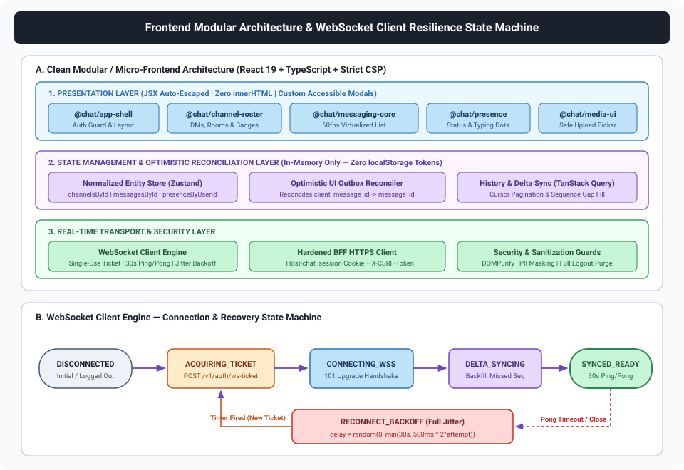
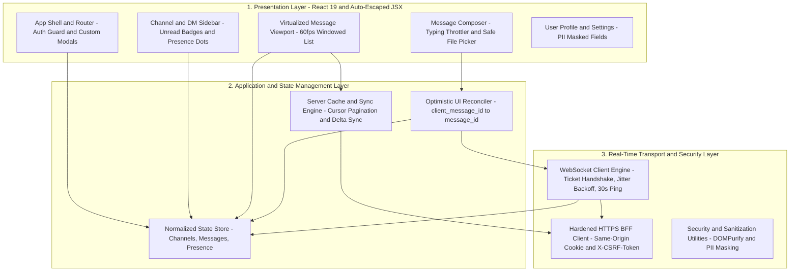
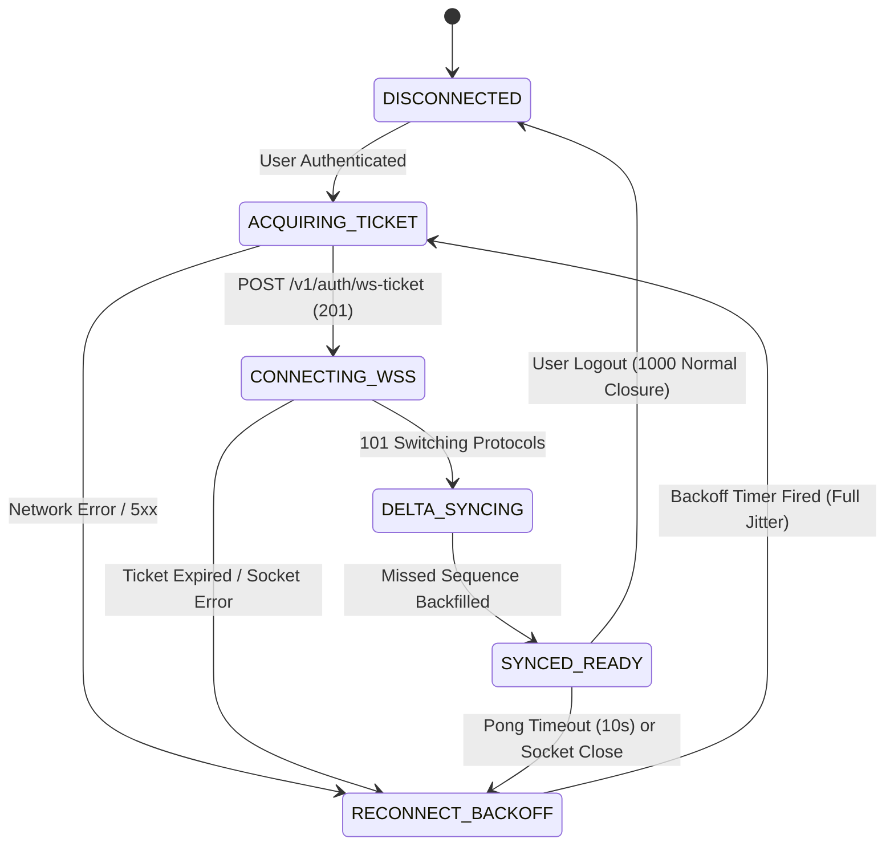

# Frontend Architecture & Design Specification: Real-Time Multi-User Chat System

> [!IMPORTANT]
> **Specification Reference**: Generated based on the **[Real-Time Multi-User Chat System Specification Document](https://docs.google.com/document/d/1_dCF0wfrX__W8cyqYVHYKz882pfCyeQdqVA0Ee6FQ2A/edit?tab=t.0)**.

This document defines the Frontend Architecture and Design Specification for the Real-Time Multi-User Chat Web Application, engineered for **sub-16ms UI frame rendering (60 FPS)**, resilient real-time WebSocket synchronization, optimistic UI updates, and strict compliance with mandatory web security standards.

---

## 1. High-Level Frontend Architecture (Modular & Micro-Frontend Ready)

The web frontend is architected as a modular **React + TypeScript** application following **Clean Architecture** and **Domain-Driven Micro-Frontend boundaries**, communicating exclusively through a secure **Backend-for-Frontend (BFF) / API Gateway**.





### 1.1 Domain Module Breakdown (Micro-Frontend Boundaries)

1. **`@chat/app-shell`**: Owns layout orchestration, Content Security Policy nonce injection, global authentication state, session timeout listeners, and accessible framework-native modal dialogs (replacing all native browser `alert`/`confirm`/`prompt` calls).
2. **`@chat/auth-session`**: Manages login/logout flows, CSRF token in-memory storage, single-use WebSocket ticket acquisition (`POST /v1/auth/ws-ticket`), and complete state purge + hard redirect on logout.
3. **`@chat/channel-roster`**: Manages 1-on-1 DM list, Group Room hierarchy, unread message counters, and channel creation modals.
4. **`@chat/messaging-core`**: Owns the virtualized message timeline, cursor-based infinite upward scroll, optimistic message outbox, read receipt intersection observers, and message reconciliation.
5. **`@chat/presence-typing`**: Subscribes to `presence_update` and `typing_indicator` WebSocket streams, maintaining ephemeral TTL timers in memory for active channel indicators.
6. **`@chat/media-uploader`**: Validates file extensions, MIME types, and size (`<= 10 MB`) client-side before requesting pre-signed upload URLs from the BFF.

---

## 2. Real-Time WebSocket Client Engine Design

To support seamless connectivity across flaky mobile/Wi-Fi networks and backend rolling deployments across 1M concurrent connections, the frontend `WebSocketClientEngine` implements a deterministic finite state machine:

### 2.1 Connection State Machine



### 2.2 Key Resilience Mechanisms

1. **Single-Use Ticket Handshake**:
   - Before every connection or reconnection attempt, the client requests a fresh 30-second `ws_ticket` via `POST /v1/auth/ws-ticket` (using its `HttpOnly` cookie and `X-CSRF-Token`).
   - This prevents long-lived tokens from ever appearing in WebSocket URLs or browser memory.
2. **Exponential Backoff with Full Jitter**:
   - To prevent a "thundering herd" against `Auth Service` and `Chat Gateway` pods if a regional load balancer blips (e.g., 50,000 clients reconnecting simultaneously), reconnect delay is calculated as:
     $$\text{delay} = \text{random}\left(0, \min\left(30000\text{ ms}, 500\text{ ms} \times 2^{\text{attempt}}\right)\right)$$
3. **Heartbeat Monitor & Zombie Socket Detection**:
   - The client transmits a `heartbeat_ping` frame every `30,000 ms`.
   - If a `heartbeat_pong` is not received within `10,000 ms`, the client proactively closes the zombie socket (`ws.close(4000, "Heartbeat timeout")`) and transitions immediately to `RECONNECT_BACKOFF`.
4. **Sequence Gap Detection & Delta Sync**:
   - Every message in a channel carries a strictly increasing `sequence_num` (`1041, 1042, 1043...`).
   - If the client's local state for `chn_123` is at `sequence_num = 1041` and it receives `receive_message` with `sequence_num = 1045`, the engine detects a gap (`1042..1044`) and immediately triggers `GET /v1/channels/chn_123/messages?after_seq=1041&before_seq=1045` to backfill missed messages without UI duplication.

---

## 3. State Management, Optimistic UI & Rendering Performance

### 3.1 Normalized In-Memory Store Schema

To avoid deeply nested React re-renders when a single presence status or message updates at high frequency, state is normalized in memory:

```typescript
interface ChatStateStore {
  // In-memory CSRF token (never persisted to localStorage)
  csrfToken: string | null;

  // Normalized Entities
  usersById: Record<string, UserProfile>;
  presenceByUserId: Record<string, { status: 'ONLINE' | 'OFFLINE' | 'AWAY' | 'DND'; lastSeenAt: string }>;
  channelsById: Record<string, ChannelMetadata>;

  // Ordered message IDs per channel (sorted by sequence_num ASC)
  messageIdsByChannel: Record<string, string[]>;
  messagesById: Record<string, MessageEntity>;

  // Optimistic Outbox (keyed by client_message_id)
  pendingMessagesByClientId: Record<string, OptimisticMessage>;

  // Ephemeral Typing Map: channelId -> { userId -> expiresAtTimestamp }
  typingUsersByChannel: Record<string, Record<string, number>>;
}
```

### 3.2 Optimistic UI Lifecycle (`<16ms` Perceived Send Latency)

1. **User Presses Enter**:
   - Client generates `client_message_id = crypto.randomUUID()`.
   - Inserts an `OptimisticMessage` (`status: 'SENDING'`) into `pendingMessagesByClientId` and renders it immediately in the active channel timeline with a subtle "Sending..." indicator.
   - Transmits `send_message` frame over WebSocket.
2. **Server `message_ack` Arrives (`<200ms`)**:
   - Reconciler matches `payload.client_message_id`, removes the entry from `pendingMessagesByClientId`, inserts the canonical `MessageEntity` (`message_id`, `sequence_num`, `status: 'PERSISTED'`) into `messagesById`, and deduplicates against any concurrent `receive_message` echo.
3. **Failure / Offline Retry**:
   - If no `message_ack` arrives within `10 seconds` or the socket disconnects, the message transitions to `status: 'FAILED_RETRYABLE'`, displaying an inline "Retry / Delete" action button without losing the user's typed text.

### 3.3 Virtualized Rendering (60 FPS Timeline)

- Chat channels can contain millions of historical messages. The `MessageViewport` uses **windowed virtualization** (`@tanstack/react-virtual`), rendering only the ~25–35 DOM nodes currently visible inside the scroll container plus an overscan of 5 items.
- **IntersectionObserver for Read Receipts**: As unread messages enter the viewport for `>= 500ms`, a debounced `read_receipt` WebSocket event updates `last_read_sequence_num`.

---

## 4. Mandatory Frontend Security Architecture

The frontend architecture strictly enforces all rules from the **Mandatory Secure Web Skills**:

### 4.1 XSS Prevention & Safe DOM Rendering

- **Framework-Native Escaping**: All message content, usernames, channel topics, and filenames are rendered via standard React JSX expressions (`<div>{message.content}</div>`), which automatically HTML-encodes untrusted characters (`<`, `>`, `&`, `"`, `'`).
- **Quoted Attributes**: All dynamic attributes in templates are strictly quoted (`className={...}`).
- **Ban on Unsafe DOM APIs**:
  - `dangerouslySetInnerHTML`, `innerHTML`, `outerHTML`, `document.write`, and `insertAdjacentHTML` are banned via ESLint (`no-unsanitized`, `react/no-danger`).
  - If rich-text markdown rendering is required in the future, HTML output **MUST** pass through `DOMPurify.sanitize(rawHtml, { ALLOWED_TAGS: ['b', 'i', 'em', 'strong', 'code', 'pre', 'a'], ALLOWED_ATTR: ['href', 'rel', 'target'] })` before rendering.
  - Any vanilla DOM utility (e.g., dynamic title or badge updates) **MUST** use `element.textContent = value`, `document.createElement()`, `element.replaceChildren()`, and `DOMParser` for static SVGs.

### 4.2 Session Storage & Logout Lifecycle (Zero `localStorage` Tokens)

- **No Tokens in Web Storage**: Authentication tokens, session IDs, and WebSocket tickets **MUST NEVER** be stored in `localStorage`, `sessionStorage`, or non-`HttpOnly` cookies where they could be exfiltrated via XSS.
- **Hardened Cookie Strategy**: The browser automatically attaches the `__Host-chat_session` (`HttpOnly; Secure; SameSite=Lax`) cookie on same-origin BFF requests (`fetch(url, { credentials: 'same-origin' })`). The `csrfToken` is kept strictly in a closure variable in JavaScript memory.
- **Secure Logout Handler**:
```typescript
export async function handleSecureLogout(): Promise<void> {
  try {
    await fetch('/v1/auth/logout', {
      method: 'POST',
      credentials: 'same-origin',
      headers: {
        'Content-Type': 'application/json',
        'X-CSRF-Token': authMemoryStore.getCsrfToken() ?? '',
      },
    });
  } finally {
    // 1. Close active WebSocket connection immediately
    wsClientEngine.disconnect(1000, 'User logged out');
    // 2. Purge all in-memory stores (Zustand/Redux, TanStack Query cache, closures)
    chatStore.getState().resetAllState();
    queryClient.clear();
    authMemoryStore.clear();
    // 3. Trigger full page redirect to clear browser memory heap & back-button cache
    window.location.replace('/login');
  }
}
```

### 4.3 Content Security Policy (CSP), SRI & Security Headers

The BFF / Frontend server delivers every HTML response with the following mandatory HTTP headers:

```http
Content-Security-Policy: default-src 'self'; script-src 'self' 'nonce-{{SERVER_GENERATED_NONCE}}' 'strict-dynamic'; style-src 'self' 'nonce-{{SERVER_GENERATED_NONCE}}'; img-src 'self' https://cdn.chat.example.com data:; connect-src 'self' https://api.chat.example.com wss://ws.chat.example.com; font-src 'self'; object-src 'none'; base-uri 'self'; form-action 'self'; frame-ancestors 'none'; upgrade-insecure-requests;
X-Frame-Options: DENY
X-Content-Type-Options: nosniff
Referrer-Policy: strict-origin-when-cross-origin
Permissions-Policy: camera=(), microphone=(), geolocation=(), payment=()
Cache-Control: no-store, no-cache, must-revalidate, max-age=0
```

- **Subresource Integrity (SRI)**: All dependencies are bundled via package manager (`npm`/`pnpm`) with locked versions. If any external asset is ever loaded, exact patch versions and `integrity="sha384-..."` + `crossorigin="anonymous"` attributes are mandatory.

### 4.4 PII Masking, Safe Logging & Native Dialog Ban

- **PII Masking**: Full email addresses or phone numbers are never rendered directly in UI labels.
```typescript
export function maskEmail(email: string): string {
  const [localPart, domain] = email.split('@');
  if (!localPart || !domain) return '***@***';
  const visibleStart = localPart.slice(0, 1);
  return `${visibleStart}***@${domain}`;
}

export function maskPhoneNumber(phone: string): string {
  const digits = phone.replace(/\D/g, '');
  return `***-***-${digits.slice(-4)}`;
}
```
- **Zero Sensitive Console Logging**: `console.log`, `console.warn`, and `console.error` are restricted by linter rules from printing user profile objects, message payloads, or tokens. Only generic diagnostic status codes are logged in development.
- **No Native Blocking Dialogs**: `window.alert()`, `window.confirm()`, and `window.prompt()` are strictly prohibited. All confirmations (e.g., leaving a channel, deleting a message) use accessible React `<Dialog>` components (`<dialog>` element with ARIA attributes).

---

## 5. Frontend & Backend Security Verification Plan

To validate compliance with all security requirements prior to deployment, the following verification steps are mandatory:

| Verification Category | Test / Verification Method | Expected Pass Criteria |
| :--- | :--- | :--- |
| **1. XSS & DOM Manipulation Audit** | Automated AST scan (`eslint-plugin-security`, `react/no-danger`) + grep check for `innerHTML`, `outerHTML`, `document.write`, `insertAdjacentHTML`, `dangerouslySetInnerHTML`. | Zero occurrences of unsafe DOM sinks; all rich text (if enabled) wrapped in `DOMPurify.sanitize()`. |
| **2. Session & Storage Inspection** | Automated Playwright E2E test inspecting `window.localStorage`, `window.sessionStorage`, and `document.cookie` after login and during active chat. | `localStorage` and `sessionStorage` contain zero auth/session tokens; `document.cookie` does not expose `__Host-chat_session` (`HttpOnly` verified). |
| **3. CSRF Enforcement Test** | Integration test firing `POST /v1/channels`, `POST /v1/auth/ws-ticket`, and `POST /v1/auth/logout` with missing or tampered `X-CSRF-Token` header. | API Gateway / Auth Service rejects 100% of requests with `403 Forbidden`. |
| **4. JWT & WS Ticket Security Test** | Attempt WebSocket handshake with (a) `alg: "none"` JWT, (b) expired ticket, and (c) replayed `ws_ticket` used 10ms earlier. | All three handshakes rejected with `401 Unauthorized`; secret loading verified to use KMS/environment without hardcoded fallback literals. |
| **5. SQL Injection & Least Privilege** | Static analysis verifying all Cloud Spanner queries use `@param` bindings + IAM policy inspection of service accounts. | Zero string-concatenated queries; mTLS enabled; read-only service accounts lack `INSERT`/`UPDATE`/`DELETE`/`DROP` permissions. |
| **6. File Upload Verification** | Upload test suite submitting: (a) `.exe` renamed to `.png` (magic-byte mismatch), (b) 15 MB file, (c) SVG with XXE `<!ENTITY>` payload. | All malicious uploads rejected with `400`/`415`/`413`; valid downloads served from isolated bucket with `Content-Disposition: attachment` and `X-Content-Type-Options: nosniff`. |
| **7. HTTP Headers & Local Binding** | Verify response headers (`CSP`, `X-Frame-Options: DENY`, `X-Content-Type-Options: nosniff`, `Cache-Control: no-store`) and verify local test servers bind only to `127.0.0.1`. | All security headers present; local test listeners bound strictly to `127.0.0.1` (never `0.0.0.0`). |
